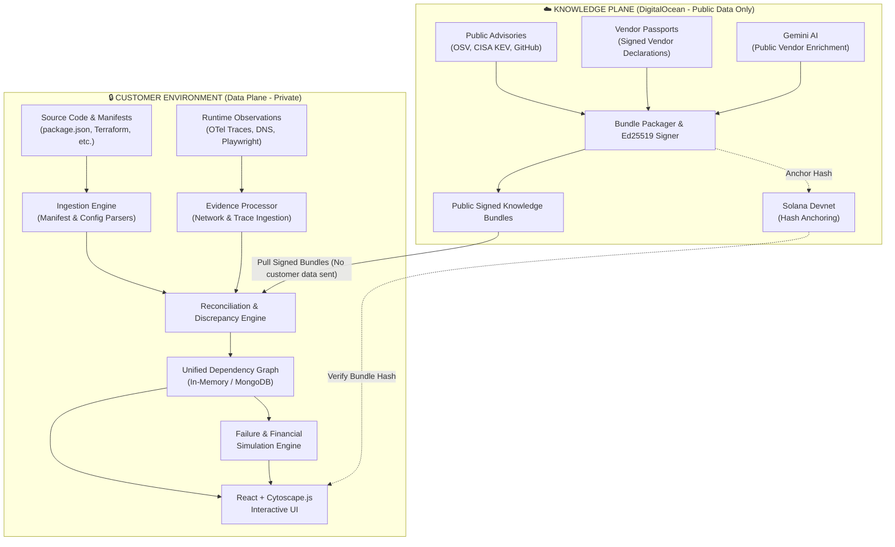
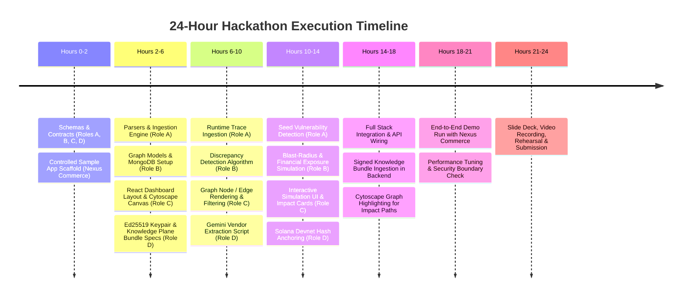

# BlindSpot

> **Know what you depend on. Know what breaks. Know what it costs.**

[](LICENSE)
[](https://fastapi.tiangolo.com)
[](https://react.dev)
[](https://www.docker.com)
[](#privacy-first-architecture)
[](https://solana.com)

---

## Executive Summary

Modern software applications are not isolated systems. They depend on hundreds of external components: third-party APIs, payment gateways, identity providers, DNS providers, CDNs, cloud infrastructure, and open-source software libraries.

Organizations suffer from a dangerous architectural blindspot: **their documented architecture disagrees with their actual runtime behavior.**

```
   ┌───────────────────────────────────────────────────────────────┐
   │                  THE DEPENDENCY BLINDSPOT                     │
   ├───────────────────────────────┬───────────────────────────────┤
   │    DECLARED ARCHITECTURE      │       OBSERVED RUNTIME        │
   │  (What developers document)   │  (What code actually calls)   │
   ├───────────────────────────────┼───────────────────────────────┤
   │  ✓ Payment Gateway (Stripe)   │  ✓ Payment Gateway (Stripe)   │
   │  ✓ Auth Provider (Auth0)      │  ✓ Auth Provider (Auth0)      │
   │  ✗ [Undocumented]             │  ⚠️ Third-party Analytics API │
   │  ✗ [Transitive Dep Hidden]    │  ⚠️ Compromised CDN Telemetry │
   │  ✗ [Upstream Unknown]         │  ⚠️ DNS Single Point Failure  │
   └───────────────────────────────┴───────────────────────────────┘
```

**BlindSpot** is a privacy-first dependency intelligence and resilience platform. It reconciles declared architectures with live runtime observations, uncovers hidden risks, traces transitive vendor dependencies via verifiable Vendor Passports, and simulates blast-radius failures with quantified financial exposure.

---

## Key Differentiators

| Capability | Legacy Scanners / Observability | BlindSpot |
|---|---|---|
| **Reconciliation Engine** | Scans static manifests OR traces network packets in silos. | **Direct Reconciliation**: Compares declared architecture against observed network/trace evidence to flag discrepancies. |
| **Privacy Architecture** | Requires uploading proprietary source code or full traffic to SaaS clouds. | **Local-First Data Plane**: Proprietary source code and dependency graphs remain 100% inside your perimeter. |
| **Vendor Transitivity** | Stops at direct API boundary; third-party internals are black boxes. | **Vendor Dependency Passports**: Signed JSON disclosures linking nested vendor dependencies (e.g. Stripe → AWS → Akamai). |
| **Failure Simulation** | Raw network graphs without clear business connection. | **Business Journey Impact**: Simulates failure of any node and computes financial risk using transaction volume and drop rates. |
| **Verifiable Knowledge** | Proprietary threat feeds with zero cryptographic proof of integrity. | **Ed25519 Signed Bundles + Solana Devnet**: Cryptographically signed bundles anchored on public ledger. |

---

## System Architecture

HDX separates data governance into two completely decoupled planes:



### 1. Data Plane (Customer Environment)
- Runs locally or inside a private VPC via Docker Compose.
- Ingests code manifests, deployment specs, and telemetry.
- Computes dependencies, discrepancies, security findings, and failure scenarios.
- **Customer source code, logs, and graphs never leave the local environment.**

### 2. Knowledge Plane (Public Cloud)
- Hosted on cloud infrastructure (DigitalOcean).
- Aggregates public security advisories (OSV, CISA KEV) and verified Vendor Passports.
- Uses Gemini AI to structure unstructured public vendor disclosures.
- Signs every knowledge bundle with **Ed25519** and anchors integrity hashes on **Solana Devnet**.
- Data Plane retrieves bundles in **Vault Mode** (offline air-gapped) or **Hybrid Mode** (auto-update).

---

## The 4 Evidence Categories

Every node and edge in the HDX Graph is tagged with cryptographic provenance and evidence classification:

1. **Declared Dependencies**: What the organization says it uses (`package.json`, `go.mod`, `Dockerfile`, Kubernetes manifests, Terraform).
2. **Observed Dependencies**: What the application communicates with at runtime (OpenTelemetry traces, DNS/proxy logs, Playwright browser crawl).
3. **Deployed Dependencies**: What infrastructure reveals is active (container registries, cloud service configs, live databases).
4. **Vendor Dependency Passports**: What upstream third parties disclose about themselves (cryptographically signed JSON passports disclosing sub-processors and CDNs).

---

## Financial Impact & Failure Simulation Formula

When any dependency fails, HDX calculates the business blast radius across all dependent journeys using the formula:

$$\text{Estimated Gross Exposure} = \sum_{j \in \mathcal{J}} \left( \text{TxPerHour}_j \times \text{AvgTxValue}_j \times \text{FailureDurationHours} \times \text{DisruptionFraction}_j \right)$$

Where:
- $\mathcal{J}$ is the set of impacted business journeys (e.g. *User Checkout*, *Account Onboarding*, *Subscription Billing*).
- $\text{TxPerHour}_j$ represents historical or configured transaction volume per hour.
- $\text{AvgTxValue}_j$ represents the average financial value per transaction.
- $\text{FailureDurationHours}$ represents hypothetical downtime duration.
- $\text{DisruptionFraction}_j$ represents the percentage of journey failures ($0.0 \le f \le 1.0$) caused by the absent dependency.

---

## Repository Structure

```
hidden-dependency-xray/
├── README.md                          # Project vision, architecture and quickstart
├── CONTRIBUTING.md                    # Team workflows, API contracts and branching rules
├── .gitignore                         # Project-wide ignore definitions
├── .env.example                       # Environment template for local & cloud services
│
├── contracts/                         # SHARED SCHEMAS & API SPECIFICATIONS [LEAD]
│   ├── graph-schema.json              # Canonical schema for graph nodes, edges and evidence
│   ├── evidence-schema.json           # Schema for declared, observed and deployed evidence
│   ├── scan-schema.json               # Schema for scan inputs and results
│   ├── finding-schema.json            # Schema for discrepancy and vulnerability findings
│   ├── scenario-schema.json           # Schema for failure simulations and financial models
│   └── openapi.yaml                   # OpenAPI 3.1 specification for backend REST API
│
├── backend/                           # PYTHON BACKEND [ROLE B & ROLE A]
│   ├── pyproject.toml                 # Backend dependencies (FastAPI, NetworkX, Motor, etc.)
│   ├── main.py                        # FastAPI application entrypoint
│   └── app/
│       ├── core/                      # Application settings, security, logging
│       ├── api/                       # API routing and endpoint implementations
│       │   ├── router.py              # Consolidated API router
│       │   └── routes/                # Endpoint controllers (scans, graph, scenarios, ai, knowledge)
│       ├── models/                    # Pydantic data models adhering to contracts/
│       ├── db/                        # MongoDB client and persistence helpers
│       ├── ingestion/                 # Parsers for manifests, Terraform, OTel traces [ROLE A]
│       ├── security/                  # Vulnerability matching (OSV, CISA KEV) [ROLE A]
│       ├── graph/                     # Graph builder, NetworkX traversals [ROLE B]
│       ├── analysis/                  # Failure blast-radius & financial calculation [ROLE B]
│       └── integrations/              # External service connectors [ROLE D]
│           ├── gemini/                # Gemini client for vendor profile extraction
│           ├── knowledge/             # Knowledge bundle ingestion & verification
│           ├── signing/               # Ed25519 signature validation
│           └── solana/                # Solana Devnet hash verification
│
├── frontend/                          # REACT + CYTOSCAPE.JS DASHBOARD [ROLE C]
│   ├── package.json                   # React, Vite, Cytoscape, Tailwind CSS dependencies
│   └── src/
│       ├── api/                       # API clients calling backend endpoints
│       ├── components/                # UI widgets (Graph viewer, blast-radius card, badges)
│       ├── pages/                     # Main views (Overview, Graph, Simulations, Passports)
│       ├── features/                  # Domain-specific interactive workflows
│       ├── hooks/                     # Custom React hooks
│       ├── types/                     # TypeScript definitions generated from contracts
│       └── styles/                    # Tailwind CSS configuration and theme rules
│
├── demo/                              # CONTROLLED SAMPLE PROJECT [ROLE A]
│   └── nexus-commerce/                # Realistic mock e-commerce store
│       ├── frontend/                  # React customer frontend with seeded analytics tag
│       ├── app/                       # Node/Python backend with mock routes
│       ├── package.json               # Declared dependencies (with seeded vulnerable library)
│       ├── package-lock.json
│       ├── composer.json              # Declared PHP dependencies
│       ├── composer.lock
│       ├── Dockerfile                 # Container packaging definition
│       ├── docker-compose.yml         # Multi-service composition
│       ├── infrastructure/            # Terraform configs with declared AWS/GCP providers
│       └── README.md                  # Nexus Commerce setup and injection notes
│
├── fixtures/                          # REPRODUCIBLE TEST INPUTS [ROLE A]
│   ├── runtime/                       # Mock OpenTelemetry traces, DNS logs, browser crawls
│   └── expected/                      # Expected discrepancy findings and simulation outputs
│
├── knowledge-plane/                   # PUBLIC KNOWLEDGE INFRASTRUCTURE [ROLE D]
│   ├── schemas/                       # Schemas for vendor passports & knowledge bundles
│   ├── sample-data/                   # Curated vendor passports (Stripe, Twilio, Cloudflare)
│   ├── bundles/                       # Sample signed knowledge bundles
│   ├── publisher/                     # Script to bundle advisories, sign with Ed25519, & push
│   ├── solana/                        # Solana anchor contract/script for bundle hashes
│   ├── service/                       # Lightweight bundle distribution server
│   └── README.md                      # Knowledge plane operation guide
│
├── tests/                             # AUTOMATED TEST SUITE
│   ├── ingestion/                     # Ingestion parser unit tests [ROLE A]
│   ├── graph/                         # Graph builder and traversal tests [ROLE B]
│   ├── api/                           # Endpoint integration tests [ROLE B]
│   └── integrations/                  # Gemini, Ed25519 & Solana integration tests [ROLE D]
│
├── scripts/                           # AUTOMATION & SETUP SCRIPTS [LEAD]
│   ├── setup.ps1                      # Complete environment bootstrapping script
│   ├── start.ps1                      # One-click startup for backend, frontend & db
│   └── test.ps1                       # Run full test suite across backend and frontend
│
└── docs/                              # COMPREHENSIVE DOCUMENTATION [LEAD]
    ├── architecture.md                # System topology and component interactions
    ├── data-flow.md                   # Step-by-step data lifecycle: ingestion to UI
    ├── api-guide.md                   # REST API usage documentation with curl examples
    └── demo-guide.md                  # Hackathon 5-minute presentation script
```

---

## Team Division of Work

| Role | Engineer | Focus Area | Deliverables |
|---|---|---|---|
| **Lead / Architect** | System Lead | Core Contracts, Automation, Docs | Shared JSON Schemas, OpenAPI spec, setup scripts, system documentation |
| **Role A** | Scanner & Backend | Manifests, Configs & Ingestion | Manifest parsers (`package.json`, `composer.json`, Terraform), OTel trace parser, Demo app (`nexus-commerce`), seeded vulnerabilities |
| **Role B** | Graph & Simulation | Graph Engine & Business Impact | MongoDB models, NetworkX graph engine, discrepancy detector, blast-radius calculator, financial exposure simulation API |
| **Role C** | Frontend | Interactive UI & Visualization | React + Vite UI, Cytoscape.js dependency graph, interactive failure simulator, discrepancy viewer, financial exposure dashboard |
| **Role D** | Knowledge & Trust | Knowledge Plane & Trust Anchors | DigitalOcean bundle publisher, Ed25519 signing, Gemini vendor data structuring, Solana Devnet hash anchoring |

---

## 24-Hour Hackathon Roadmap



---

## 5-Minute Hackathon Demo Script

1. **Step 1: Ingest & Discover**
   - Import the **Nexus Commerce** codebase and deployment manifests.
   - Run HDX discovery engine in under 3 seconds.
2. **Step 2: Inspect Declared Architecture**
   - Show internal microservices: Storefront, Order Service, Database, Payment (Stripe), Auth (Auth0).
3. **Step 3: Reveal the Hidden Dependency**
   - Switch on the **Runtime Observations** layer.
   - Instantly highlight an **undocumented external endpoint** (`analytics-telemetry.untrusted-cdn.net`) captured from browser/trace data but completely absent from manifests!
4. **Step 4: Analyze Vulnerability Propagation**
   - Click a seeded compromised transitive library (`event-stream` / `jsonwebtoken` variant) to trace its blast path up to user authentication.
5. **Step 5: Simulate Dependency Failure**
   - Select payment processor **Stripe** and trigger **Simulate Outage**.
   - Watch the graph cascade in red across Checkout, Subscriptions, and Order Processing.
6. **Step 6: Quantify Financial Exposure**
   - Display the real-time financial impact banner:
     $$\$45\text{/tx} \times 1,200\text{ tx/hr} \times 4\text{ hours} \times 1.0\text{ disruption} = \mathbf{\$216,000 \text{ Exposure}}$$
   - Present automated mitigations: failover routing to secondary gateway, retry queuing.
7. **Step 7: Cryptographic Trust Verification**
   - Inspect the upstream **Vendor Dependency Passport** for Stripe disclosing its reliance on AWS US-East-1.
   - Verify the Ed25519 signature and confirm transaction anchoring on **Solana Devnet**.

---

## Quickstart Guide

### Prerequisites
- [Docker & Docker Compose](https://www.docker.com/)
- [Python 3.11+](https://www.python.org/)
- [Node.js 18+](https://nodejs.org/)
- PowerShell (Windows) or bash (Linux/macOS)

### 1. Clone & Setup Environment
```powershell
# Clone the repository
git clone https://github.com/your-org/hidden-dependency-xray.git
cd hidden-dependency-xray

# Bootstrap project dependencies and environment files
.\scripts\setup.ps1
```

### 2. Configure Environment
Copy `.env.example` to `.env` and fill in optional API keys:
```powershell
Copy-Item .env.example .env
```

### 3. Launch the Platform
```powershell
# Start MongoDB, FastAPI Backend, and React Frontend
.\scripts\start.ps1
```

- **Frontend Dashboard**: [http://localhost:5173](http://localhost:5173)
- **Backend API Docs (Swagger)**: [http://localhost:8000/docs](http://localhost:8000/docs)
- **Knowledge Plane Service**: [http://localhost:8080](http://localhost:8080)

### 4. Run Test Suite
```powershell
.\scripts\test.ps1
```

---

## License

This project is licensed under the MIT License - see the [LICENSE](LICENSE) file for details.

