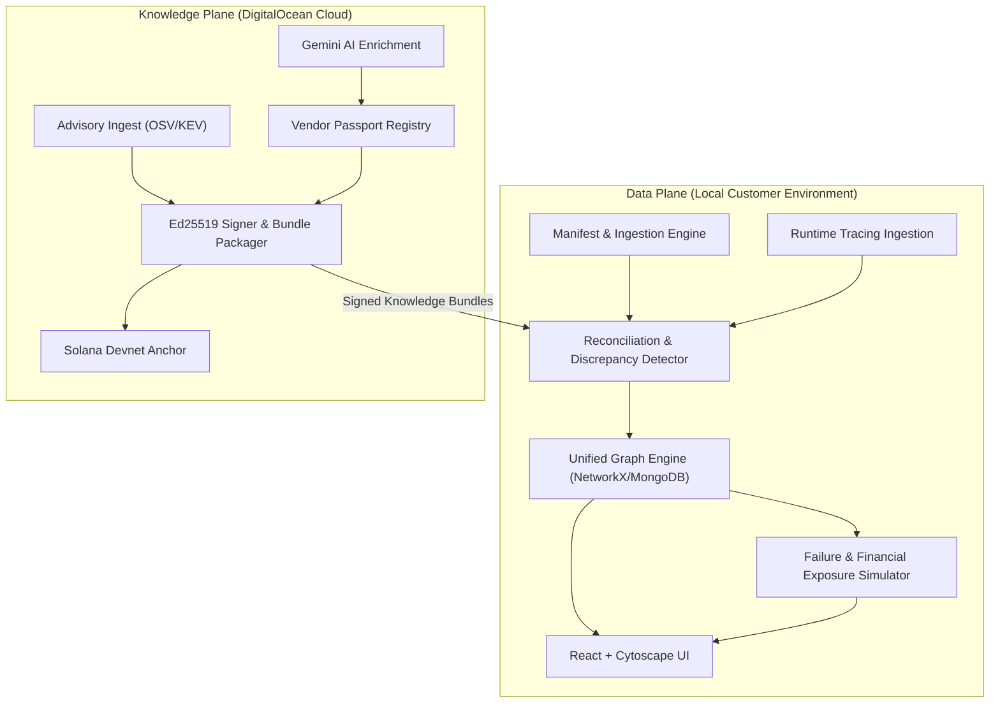

# HDX System Architecture

## Overview
Hidden Dependency X-Ray (HDX) operates on a **Local-First, Cloud-Assisted** model.

## Security & Privacy Guarantee
1. **Source Code Confidentiality**: Code repositories, manifests, and local traces are evaluated purely on the customer's machine.
2. **Zero Telemetry Exfiltration**: No outbound telemetry containing internal hostnames, credentials, or customer identifiers is emitted.
3. **Cryptographic Integrity**: Incoming bundles from the Knowledge Plane are verified with Ed25519 signatures and cross-checked against Solana Devnet transaction roots.

